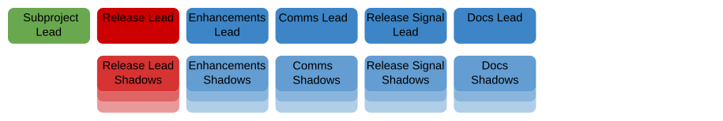
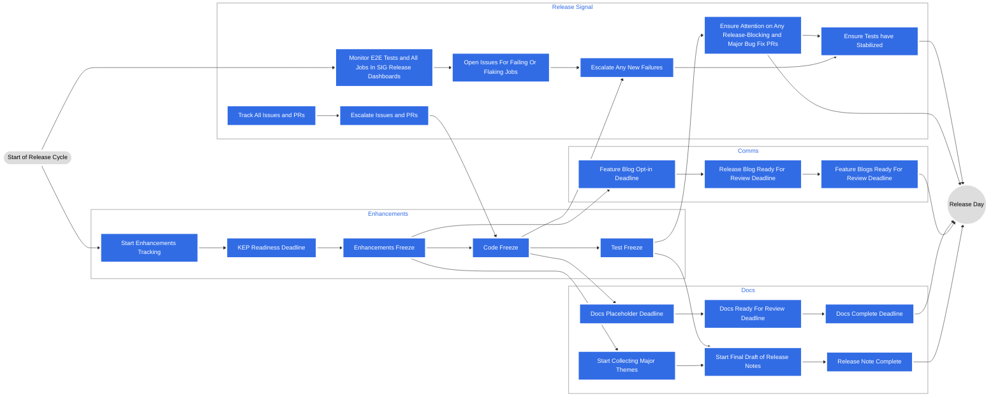
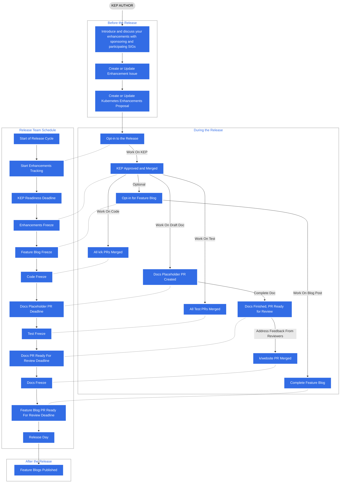

# Kubernetes Release Team

- [Overview][overview]
- [Specific responsibilities][specific-responsibilities]
- [Kubernetes Release Team roles][kubernetes-release-team-roles]
  - [Release Team Shadows](#release-team-shadows)
  - [Individual Contributors](#individual-contributors)
- [Other activities of the Release Team][other-activities-of-the-release-team]
- [Release Team Selection][release-team-selection]
- [Milestone Maintainers][milestone-maintainers]
- [Filing exceptions][filing-exceptions]
- [Visual Release Path](#visual-release-path)

## Overview

The Kubernetes Release Team is embedded within SIG Release and is responsible for the day to day work required to
successfully release while the SIG at large is focused on the continued improvement of the release process. Historically
the Release Manager (previously Release Czar)
and later Release Team have assumed the following responsibilities:
- Authority to build and publish releases at the published release date under the auspices of the CNCF
- Authority to accept or reject cherrypick merge requests to the release branch
- Authority to accept or reject PRs to the kubernetes/kubernetes master branch during code freeze period
- Changing the release timeline as needed if keeping it would materially impact the stability or quality of the release

These responsibilities will continue to be discharged by SIG Release through the Release Team. The
[SIG Release charter](https://git.k8s.io/community/sig-release/charter.md) grants SIG
Release the following additional responsibilities:
- Authority to revert code changes which imperil the ability to produce a release by the communicated date or otherwise
  negatively impact the quality of the release (e.g. insufficient testing, lack of documentation)
- Authority to guard code changes behind a feature flag which do not meet criteria for release
- Authority to close the submit queue to any changes which do not target the release as part of enforcing the code freeze
  period
which shall be the discharged by the Release Team.

## Specific responsibilities

- Generation of release notes
- Communicate enhancement burndown progress during a release cycle
- Manage repositories and tooling dedicated to releasing Kubernetes which at time of chartering these include:
  - kubernetes/release
  - deb/rpm packaging and hosting
  - Container image hosting
- Set and enforce criteria for repository inclusion in a Kubernetes release
  - Governance
  - Stabilization
  - Test coverage
- Set and enforce criteria for code inclusion in a Kubernetes release
  - Feature flags
  - Documentation
  - Test coverage
  - Dashboards
  - Status reports
- Define template and format for communication of release status
  - Ongoing status of the release process
  - Announcement of alpha, beta, release candidate availability
  - Announcement of release availability
- Deriving signal from the following sources
  - [test grid](https://testgrid.k8s.io/)
  - GitHub [flake issues](https://github.com/kubernetes/kubernetes/issues?q=is%3Aopen+is%3Aissue+label%3Akind%2Fflake)
  - GitHub [bug issues](https://github.com/kubernetes/kubernetes/issues?utf8=%E2%9C%93&q=is%3Aopen%20is%3Aissue%20label%3Akind%2Fbug)
- Identifying owning individuals and SIGs for blocking issues
- Working with SIGs and individuals to drive resolution of open issues
- Building summary of release criteria and status and publish to the community on a regular basis throughout the release cycle
- Manage the contents of `kubernetes/enhancements`
- Define burndown process
  - use of GitHub labels to signal release blocking status
  - use of GitHub milestones to communicate release blocking issues
  - use of flake GitHub issue count or CI signal as a release blocking status
- Coordinate the resolution of release blocking issues

## Kubernetes Release Team roles

As documented in the [Kubernetes Versioning doc](../release-engineering/reference/versioning.md),
there are 3 types of Kubernetes releases:
- Major (x.0.0)
- Minor (x.x.0)
- Patch (x.x.x)

| Role              | Handbook                                                                 |
|-------------------|--------------------------------------------------------------------------|
| Release Team Lead | [Lead Handbook](role-handbooks/release-team-lead/README.md)              |
| Enhancements      | [Enhancements Handbook](role-handbooks/enhancements/README.md)           |
| Release Signal    | [Release Signal Handbook](role-handbooks/release-signal/README.md)       |
| Docs              | [Docs Handbook](role-handbooks/docs/README.md)                           |
| Communications    | [Communications Handbook](role-handbooks/communications/README.md)       |
| Emeritus Adviser  | [Emeritus Adviser Handbook](role-handbooks/emeritus-adviser/README.md)   |

The Release Team is supported by the [Release Managers](https://git.k8s.io/website/content/en/releases/release-managers.md)
of the Release Engineering subproject, who cut the releases and manage the
release branches. The Release Manager assigned to a release cycle is listed as
"Branch Manager" in the release's `release-team.md` file.

Related documents:

- [Release Team Selection](release-team-selection.md)
- [Release Team Onboarding Guide](release-team-onboarding.md)
- [Release Team Shadows](shadows.md)
- [Release Team Removal Process](release-team-removal.md)

#### Retired Release Team roles

- Patch Release Manager: moved to a role of [Release Managers](https://git.k8s.io/website/content/en/releases/release-managers.md), which operates under the Release Engineering subproject.
- Branch Manager: moved to a role of [Release Managers](https://git.k8s.io/website/content/en/releases/release-managers.md), which operates under the Release Engineering subproject.
- Test Infra: deprecated at the end of Kubernetes 1.15. Duties are now distributed to the [Release Managers](/release-engineering/handbooks/release-manager.md) and [Test Infra On-call (SIG Testing)](https://go.k8s.io/oncall) (#testing-ops and #sig-testing on Slack).
- CI Signal and Bug Triage: merged into the Release Signal role.
- Release Notes: merged into the Docs role.

### Release Team Shadows

Any Release Team role lead may select one or more mentees to shadow the release process in order to help fulfill future
Release Team staffing requirements and continue to grow the Kubernetes community in general. Potential mentees should
be prepared to devote a significant amount of time to shadowing their mentor during the release cycle. Successful Release Team Shadows
should be prepared to assume a lead role in a subsequent release. See the [Release Team Shadows guide](shadows.md) for details.

### Individual Contributors

Release responsibilities of individual contributors to the Kubernetes project are captured below.

#### During a patch release

If you have a patch that needs to be ported back to a previous release (meaning it is a critical bug/security fix), once it is merged to the Kubernetes `master` branch:
- Follow the [cherry-pick instructions to open a cherry-pick PR.](https://git.k8s.io/community/contributors/devel/sig-release/cherry-picks.md)
- The Release Managers will then review the PR and if it is ok for cherry-picking, will apply a `cherry-pick-approved` label to it.

#### During a major/minor release

##### Propose and track enhancement

If you are developing an enhancement for Kubernetes, make sure that an issue is open in the [enhancements repository](https://github.com/kubernetes/enhancements/issues). If you are targeting a particular release, make sure the issue is marked with the corresponding release milestone and follow the deadlines in the [release phases](/releases/release_phases.md).

Ensure that all code for your enhancement is written, tested, reviewed, and merged before the code freeze date for the target release.

During the code freeze period, fix any bugs discovered with your enhancement, and write enhancement documentation.

##### Write enhancement documentation

1. Make sure your enhancement for the upcoming release is on the Release Tracking Board. The board is linked from the `links.md` file of the current release directory under [releases](../releases).
2. Create a placeholder PR with documentation for your enhancement in the [kubernetes/website](https://github.com/kubernetes/website) repository by the [Docs Placeholder PR Deadline](/releases/release_phases.md#docs-placeholder-pr-deadline).
    - **Your PR must target the `dev-1.XX` branch for the release in development, not `main`.** Changes to `main` go live on https://kubernetes.io/docs/ as soon as they are merged, and release documentation must not go live before the release is cut.
3. Add the link to your docs PR on the Release Tracking Board and notify the Docs Lead for the release. The Release Team for each release is listed in the `release-team.md` file of the release directory.
4. Complete the documentation by the [Docs Ready for Review Deadline](/releases/release_phases.md#docs-ready-for-review-deadline). The Docs team and SIG Docs will review your PR and give you feedback.
5. Once approved, the PR is merged into the `dev-1.XX` branch before [Docs Freeze](/releases/release_phases.md#docs-freeze).
6. On release day, the Docs team merges the `dev-1.XX` branch into `main`, making your docs live on https://kubernetes.io/docs/.

See the [Docs section of the release phases](/releases/release_phases.md#docs) and the [Docs Handbook](role-handbooks/docs/README.md) for details.

## Other activities of the Release Team

### During "Major" releases

To date no major release has been scheduled, however, SIG Release would be responsible for working closely with SIG Testing
to coordinate this effort across SIGs. The precise work required to produce a major release (e.g. 2.0, 3.0)
is undefined.

### During "Security" releases

For all unplanned or embargoed releases:
- Facilitate security releases following the [Security Release Process](https://git.k8s.io/security/security-release-process.md)
  and the [Security Releases handbook](/release-engineering/handbooks/security-releases.md)

## Release Team Selection

If you're interested in learning more about how the Release Team is selected, as well as how to volunteer, please review the [Release Team Selection Process][release-team-selection-process].

---

## Milestone Maintainers

The [milestone maintainers](https://github.com/kubernetes/community/blob/master/contributors/devel/sig-release/release.md#milestone-maintainers) are responsible for adding, adapting, or removing a milestone, e.g. the next major Kubernetes release, on an enhancement, issue, PR.

Across release cycles, a "/milestone" is one of the best signals for [issue triage](https://github.com/kubernetes/community/blob/master/contributors/guide/issue-triage.md#milestones) whether or not an issue or PR is actually targeted for the current release milestone.

Adding the in-progress release milestone to pull requests after the Code Freeze is strictly prohibited, as it can compromise the stability of the release. Prior to making such changes, approval must be obtained from both the Release Team Lead and the Emeritus Adviser.

Each release cycle, the current Release Team Lead must update the membership of the [milestone-maintainers](https://github.com/orgs/kubernetes/teams/milestone-maintainers) GitHub team.

The actual process of maintaining milestones is owned by the SIGs and special elected contributors. The SIG Release team steers the enhancements through the release cycle and takes care that only well-maintained enhancements make it into a new minor release.

---

## Filing exceptions

The process for filing an enhancement exception can be found in the [exceptions document][exceptions].

[overview]: #overview
[specific-responsibilities]: #specific-responsibilities
[kubernetes-release-team-roles]: #kubernetes-release-team-roles
[other-activities-of-the-release-team]: #other-activities-of-the-release-team
[release-team-selection]: #release-team-selection
[release-team-selection-process]: release-team-selection.md
[milestone-maintainers]: #milestone-maintainers
[filing-exceptions]: #filing-exceptions
[exceptions]: /releases/EXCEPTIONS.md

## Visual Release Path

The diagram below shows a high level overview of tasks of the release team sub teams (Release Signal, Enhancements, Docs, Comms) during a release cycle.

The diagram below provides an overview of the work done by KEP authors during the release process and how it relates to release deadlines.

