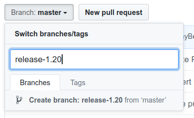
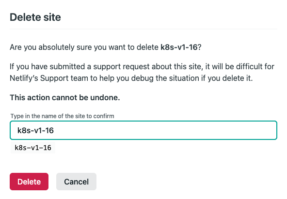
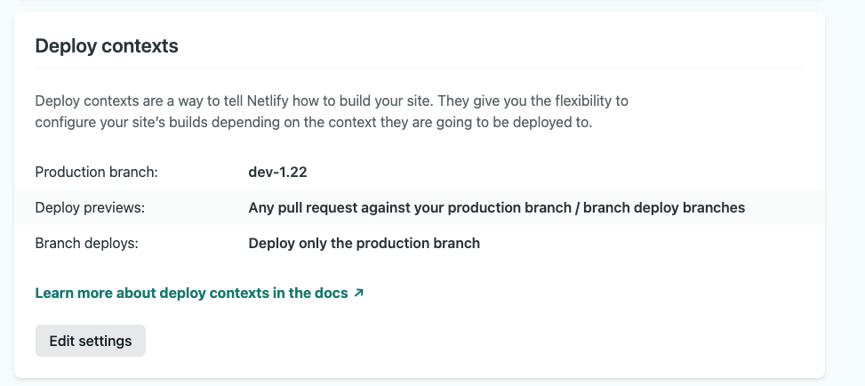

# Docs Release Timeline

- [Overview](#overview)
  - [Docs deadlines](#docs-deadlines)
  - [Responsibilities of the Docs team](#responsibilities-of-the-docs-team)
  - [Examples from the latest cycles](#examples-from-the-latest-cycles)
- [Start of the cycle](#start-of-the-cycle)
  - [Connect with the Release Team](#connect-with-the-release-team)
  - [Shadow selection and onboarding](#shadow-selection-and-onboarding)
    - [Select shadows](#select-shadows)
    - [Contact selected shadows](#contact-selected-shadows)
    - [Shadow onboarding meeting](#shadow-onboarding-meeting)
  - [Release Tracking Board](#release-tracking-board)
  - [Access and permission setup](#access-and-permission-setup)
  - [Open the integration branch](#open-the-integration-branch)
  - [Introduce yourself to the localization teams](#introduce-yourself-to-the-localization-teams)
  - [Responsibilities sign-up sheet](#responsibilities-sign-up-sheet)
  - [Update the website configuration ahead of the release](#update-the-website-configuration-ahead-of-the-release)
  - [Attend meetings and post Slack updates](#attend-meetings-and-post-slack-updates)
    - [Weekly status report checklist](#weekly-status-report-checklist)
    - [Post weekly assignments on Slack](#post-weekly-assignments-on-slack)
- [Enhancements Freeze to Code Freeze](#enhancements-freeze-to-code-freeze)
  - [Internal team coordination](#internal-team-coordination)
  - [Track PRs](#track-prs)
  - [Communicate major deadlines](#communicate-major-deadlines)
  - [Generate the release notes](#generate-the-release-notes)
    - [Set up the tools and generate the release notes](#set-up-the-tools-and-generate-the-release-notes)
    - [Periodically review and fix new release notes](#periodically-review-and-fix-new-release-notes)
    - [Review the release notes PR](#review-the-release-notes-pr)
    - [Maintain known issues](#maintain-known-issues)
  - [Before the placeholder PR deadline](#before-the-placeholder-pr-deadline)
  - [Weekly branch sync PRs](#weekly-branch-sync-prs)
    - [Merge `main` into `dev-<future release>` manually](#merge-main-into-dev-future-release-manually)
  - [Monitor and review docs PRs](#monitor-and-review-docs-prs)
    - [Style guide checklist](#style-guide-checklist)
- [Code Freeze to Docs Freeze](#code-freeze-to-docs-freeze)
  - [After Code Freeze](#after-code-freeze)
  - [Before the PRs ready for review deadline](#before-the-prs-ready-for-review-deadline)
  - [Before Docs Freeze](#before-docs-freeze)
  - [Week of Docs Freeze](#week-of-docs-freeze)
  - [After Docs Freeze](#after-docs-freeze)
  - [Handling Docs Freeze exceptions](#handling-docs-freeze-exceptions)
  - [Ensure release highlights are reflected in the notes](#ensure-release-highlights-are-reflected-in-the-notes)
  - [Get feedback from SIG leads](#get-feedback-from-sig-leads)
  - [Sync with the Comms team on the release blog post](#sync-with-the-comms-team-on-the-release-blog-post)
  - [Nominate a Docs Lead for the next release](#nominate-a-docs-lead-for-the-next-release)
- [Docs Freeze to release day](#docs-freeze-to-release-day)
  - [Final release notes preparation (critical task)](#final-release-notes-preparation-critical-task)
  - [Coordinate with SIG Docs for release day support](#coordinate-with-sig-docs-for-release-day-support)
  - [Verify SIG Cluster Lifecycle (kubeadm) documentation](#verify-sig-cluster-lifecycle-kubeadm-documentation)
  - [Curate the dependencies section](#curate-the-dependencies-section)
  - [Update the releases page](#update-the-releases-page)
  - [Coordinate with the Release Managers](#coordinate-with-the-release-managers)
  - [Update the site configuration files for previous releases](#update-the-site-configuration-files-for-previous-releases)
  - [Update the site configuration file for the future release](#update-the-site-configuration-file-for-the-future-release)
  - [Inform the localization teams](#inform-the-localization-teams)
  - [Day before release day](#day-before-release-day)
    - [Request temporary write access to the website repo](#request-temporary-write-access-to-the-website-repo)
    - [Freeze the Kubernetes website](#freeze-the-kubernetes-website)
    - [Create the release branch](#create-the-release-branch)
    - [Update Netlify](#update-netlify)
    - [Sync the branches](#sync-the-branches)
    - [Get approvals for open PRs](#get-approvals-for-open-prs)
    - [Publish the final release notes](#publish-the-final-release-notes)
    - [Review the milestone](#review-the-milestone)
- [Release day](#release-day)
  - [Merge the integration branch](#merge-the-integration-branch)
  - [Publish the release blog post](#publish-the-release-blog-post)
  - [Create the snapshot tags and release](#create-the-snapshot-tags-and-release)
  - [Unfreeze the Kubernetes website](#unfreeze-the-kubernetes-website)
  - [Close the milestone](#close-the-milestone)
- [After the release](#after-the-release)
  - [Create the next dev branch](#create-the-next-dev-branch)
  - [Modify the Prow configuration](#modify-the-prow-configuration)
  - [Create the next milestone](#create-the-next-milestone)
  - [Update Netlify for the next cycle](#update-netlify-for-the-next-cycle)
  - [Announce the new dev branch](#announce-the-new-dev-branch)
  - [Reassign issues](#reassign-issues)
  - [Clean up access](#clean-up-access)
  - [Review the docs process, update the handbook and transition](#review-the-docs-process-update-the-handbook-and-transition)
  - [Lessons learned](#lessons-learned)
  - [Celebrate!](#celebrate)

---

## Overview

This timeline describes the Docs team responsibilities throughout the
Kubernetes release cycle, grouped by release milestone. Each phase lists the
tasks, deadlines and checklists that apply. Release cycles run for 14 to 16
weeks; always use the schedule in the release directory
(`releases/release-<future release>/README.md`) for the exact dates.

The terms `<current release>` (the active Kubernetes release) and
`<future release>` (the release the team is composing) are explained in the
[handbook's common terms](README.md#common-terms).

### Docs deadlines

Read the release schedule and **make sure it includes the docs deadlines**:

- Docs placeholder PRs open in the respective KEPs: before Code Freeze, about
  seven weeks before release day.
- Docs PRs ready for review: the week after Code Freeze, about three weeks
  before release day.
- Docs Freeze, all PRs reviewed and ready to merge: around `rc.0` and the
  creation of the release branch, about two weeks before release day.
- Final release notes complete and merged: at least a day before release day.

In the v1.38 cycle these were weeks 9, 13, 14 and 16 of a 16 week cycle
(see the [v1.38 schedule](/releases/release-1.38/README.md#timeline)).

If these deadlines aren't listed in the release schedule, ask the Release
Team Lead to add them. Define deadlines clearly. Avoid "EOD", because it's
ambiguous; use Anywhere on Earth (AoE) plus the UTC equivalent instead, for
example "Thursday 21st May 2026 (AoE) / Friday 22nd May 2026, 12:00 UTC".

### Responsibilities of the Docs team

- Everything under [Responsibilities overview](README.md#responsibilities-overview)
  in the handbook.
- Track docs PRs for KEPs in the [website](https://github.com/kubernetes/website)
  repository, plus all docs PRs against the `dev-<future release>` branch
  that contain general updates without a KEP.
- By default, every opted-in KEP needs docs. Enhancement owners must confirm
  when an enhancement does not need new or updated documentation.

> [!NOTE]
> - The release blog PR is tracked by the Release Comms team.
> - The kubernetes/website repo switched from a `master` branch to a `main`
>   branch in 2021. Older example PRs still use `master`. The k/sig-release
>   repository still uses `master`.

> [!TIP]
> For the end-of-year release, KubeCon NA and the US Thanksgiving holiday can
> be additional impediments to docs deadlines. Communicate upcoming deadlines
> to enhancement owners earlier and more often.

### Examples from the latest cycles

Refresh this list each cycle instead of adding version-specific links to the
sections below.

| What | Example |
|------|---------|
| Release schedule and docs deadlines | [v1.38](/releases/release-1.38/README.md#timeline) |
| Release Tracking Board | [v1.38 links](/releases/release-1.38/links.md#releasetracking) |
| Release team file update for the Docs team | [v1.35 PR](https://github.com/kubernetes/sig-release/pull/2875) |
| k8s.io groups update for the Docs team | [v1.35 PR](https://github.com/kubernetes/k8s.io/pull/8585) |
| Integration branch PR | [v1.21 PR](https://github.com/kubernetes/website/pull/26153) |
| First `hugo.toml` PR in the dev branch | [v1.27 PR](https://github.com/kubernetes/website/pull/40231) |
| `OWNERS_ALIASES` update for approval permissions | [v1.21 PR](https://github.com/kubernetes/website/pull/26114) |
| k/org team update for the Docs team | [v1.21 PR](https://github.com/kubernetes/org/pull/2445) |
| Branch sync PR | [v1.17 PR](https://github.com/kubernetes/website/pull/16225) |
| Final release notes review PR | [v1.35 PR](https://github.com/kubernetes/sig-release/pull/2928) |
| Releases page update | [v1.29 PR](https://github.com/kubernetes/website/pull/44135) |
| Site configuration PRs for previous releases | v1.29 cycle: [1.25](https://github.com/kubernetes/website/pull/44302), [1.26](https://github.com/kubernetes/website/pull/44301), [1.27](https://github.com/kubernetes/website/pull/44299), [1.28](https://github.com/kubernetes/website/pull/44298) |
| Temporary write access PR | [v1.20 PR](https://github.com/kubernetes/org/pull/2364) |
| Release blog PR | [v1.21 PR](https://github.com/kubernetes/website/pull/27233) |
| Prow milestone applier update | [v1.22 PR](https://github.com/kubernetes/test-infra/pull/21727), [branch protection PR](https://github.com/kubernetes/test-infra/pull/30389) |
| Access cleanup PR | [v1.21 PR](https://github.com/kubernetes/org/pull/2624) |
| Known issues umbrella issue | [v1.25 issue](https://github.com/kubernetes/kubernetes/issues/110336) |

---

## Start of the cycle

Complete these steps during the first week of the cycle. Most of them take
minutes; the shadow onboarding meeting and the integration branch take a few
hours in total.

### Connect with the Release Team

- Familiarize yourself with the [Release Team and process](/release-team/README.md).
- Join the [Slack channels](/release-team/release-team-onboarding.md#slack)
  and [Google Groups](/release-team/release-team-onboarding.md#mailing-lists)
  listed in the Release Team onboarding guide.
  The Docs team additionally uses `#sig-docs`, `#release-docs` and
  `#release-notes`.
- Introduce yourself in `#sig-release` as the Docs Lead for the future
  release and send a direct message to the Release Team Lead.
- Membership of the `release-team` and `release-team-shadows` Google Groups
  is managed in git. Open a PR against `kubernetes/k8s.io` that adds the Docs
  team to both groups in
  [`groups/sig-release/groups.yaml`](https://github.com/kubernetes/k8s.io/blob/main/groups/sig-release/groups.yaml).

### Shadow selection and onboarding

#### Select shadows

You will be provided with survey results from people interested in working on
the Release Team. If you do not have the results, contact the Release Team
Lead or the Release Team Subproject Leads.

After vetting the volunteers, make a final decision on the selected shadows
together with the incoming Release Team Lead and the Release Team Subproject
Leads. In the past, the Docs team has had between three and six members. Read
the [shadow section of the selection process](/release-team/release-team-selection.md#shadows)
for the general rules.

Drop a Slack DM or email to the incoming shadows to check that they are still
interested and available, using the
[confirmation template](templates/shadow-onboarding.md#confirm-interest-and-availability).

Once all shadows have confirmed, add their contacts to the contact sheet
shared by the Release Team Lead (linked from
`releases/release-<future release>/links.md#contacts`).

> [!IMPORTANT]
> Beyond meeting the basic requirements and time commitment, a good shadow is
> someone who is active in SIG Docs. Selection priority should go to previous
> shadows who want to eventually lead a docs release. Other than those few
> guidelines, use your best judgement.

#### Contact selected shadows

- Create a Slack group with the selected shadows and post the
  [welcome message](templates/shadow-onboarding.md#welcome-message).
- Post the [first onboarding tasks](templates/shadow-onboarding.md#first-onboarding-tasks).

#### Shadow onboarding meeting

Schedule a shadow onboarding meeting with the incoming shadows. The meeting
helps everyone get to know each other and walks them through a high-level
overview of the release process and what's coming in the next few months.

- Duration: about 30 to 60 minutes.
- Record the session if possible and share the recording and slides with the
  team.

Agenda:

1. Introductions (5 to 10 minutes)
1. Release process overview (15 to 20 minutes)
1. Walk through this timeline document (15 to 20 minutes)
1. Q&A (10 to 15 minutes)
1. Set the expectation that the mantra is "hurry up and wait", but that it
   does get hectic in the last few weeks.

### Release Tracking Board

Early in the release cycle, the Enhancements Lead creates a GitHub project
for release tracking, the Release Tracking Board. It is linked from
`releases/release-<future release>/links.md#releasetracking`. Later in the
cycle, this board contains the information the Docs team works from. If you
don't have access, check that you are part of the `release-team-docs` GitHub
team.

Open the Docs view of the board and familiarize yourself with:

- Which enhancements the team will be tracking for this release.
- The feature owners and their GitHub IDs.
- The links to docs PRs opened for each enhancement.
- The docs requirement status (default: `Needs Docs`).
- The docs PR status (`No PR`, `Draft PR`, `PR Ready for Review`,
  `Complete (Merged PR)`).

The fields are described under [Track PRs](#track-prs).

### Access and permission setup

- Open a PR to add the Docs team to
  `releases/release-<future release>/release-team.md` in k/sig-release.
- Make sure the Docs team is in the `release-team` and `release-team-shadows`
  groups in [`groups/sig-release/groups.yaml`](https://github.com/kubernetes/k8s.io/blob/main/groups/sig-release/groups.yaml)
  (see [Connect with the Release Team](#connect-with-the-release-team)).
- Docs Lead only: open a PR to add yourself to the `approvers` and
  `reviewers` sections of the k/k
  [CHANGELOG OWNERS](https://github.com/kubernetes/kubernetes/blob/master/CHANGELOG/OWNERS)
  file.
- Make sure you are part of the
  [sig-docs-en-owners](https://github.com/orgs/kubernetes/teams/sig-docs-en-owners)
  team and open a PR for approval permission in the k/website
  [OWNERS_ALIASES](https://github.com/kubernetes/website/blob/main/OWNERS_ALIASES).
- Add the Docs team to the `website-milestone-maintainers` team in
  `config/kubernetes/sig-docs/teams.yaml` and to the `release-team-docs` team
  in `config/kubernetes/sig-release/teams.yaml` in k/org.
- You need push access to the k/website repo for release week. Contact a SIG
  Docs chair if you don't have it (see
  [Request temporary write access](#request-temporary-write-access-to-the-website-repo)).

### Open the integration branch

> [!CAUTION]
> The Docs Lead performs these steps.

Open the integration branch by creating a pull request against `main` from
the `dev-<future release>` branch and add the `do-not-merge/hold` label to
it. This release pull request serves as the base for the individual
enhancement docs PRs of the release and lets you bundle and merge them all at
once on release day.

Then open the first PR against `dev-<future release>`: update `hugo.toml` to
show `<future release>` as the current version and add the `<future release>`
entry to the version drop-down, so that the new branch shows itself as the
current version. See [Update the website configuration ahead of the release](#update-the-website-configuration-ahead-of-the-release)
for the commands.

### Introduce yourself to the localization teams

Create a GitHub discussion in k/sig-release using the
[localization discussion template](templates/localization-discussion.md) to
introduce yourself to the localization owners and sync on the release
timeline early.

### Responsibilities sign-up sheet

Create a multi-sheet spreadsheet with `Weekly Branch Sync`,
`Release Notes PR Creation/Review`, `Release Team Updates`,
`SIG Docs (APAC) Updates`, `SIG Docs (EMEA) Updates` and `Burndown Meeting`
sheets. It serves as the internal schedule and sign-up sheet for the Docs
team, and is used to track progress and give status during the Release Team
meetings.

Use the [responsibilities sign-up sheet template](responsibilities-signup-sheet-template.xlsx).
Import it into a Google Sheet, update the names of the shadows and share the
link with the team.

- Sheet `Weekly Branch Sync`. The weekly branch sync is typically done on a
  Friday.
  - Column A `Date`: all Fridays until the release.
  - Column B `Assignee`: assignee from the Docs team.
- Sheet `Release Notes PR Creation/Review`. Shares the generation of the
  release notes for the alpha, beta and rc releases.
  - Column A `Release`: all alpha, beta and rc releases of the cycle.
  - Column B `Branch Creation Date`: date of the release cut, which starts the work for
    the assignee.
  - Column C `PR Merge Deadline`: date by which the release notes PR should
    be merged.
  - Column D `Release Notes Assignee`: assignee from the Docs team.
  - Column E `Release Notes Reviewer`: reviewer from the Docs team.
- Sheet `Release Team Updates`. Assigns who provides the Docs update in the
  weekly Release Team meetings.
  - Column A `Date`: all weekly Release Team meetings until the release.
  - Column B `APAC`: assignee from the Docs team.
  - Column C `EMEA`: assignee from the Docs team.
- Sheet `Burndown Meeting`. Assigns who provides the Docs update in the
  burndown meetings.
  - Column A `Date`: all burndown meetings until the release.
  - Column B `APAC`: assignee from the Docs team.
  - Column C `EMEA`: assignee from the Docs team.
- Sheets `SIG Docs (EMEA) Updates` and `SIG Docs (APAC) Updates`. Assign
  who provides the update in the respective SIG Docs meetings.
  - Column A `Date`: all SIG Docs meetings until the release.
  - Column B `Assignee`: assignee from the Docs team.

### Update the website configuration ahead of the release

Update `hugo.toml` based on the version on the `main` branch and open a PR
with the change against the `dev-<future release>` branch (which should
already exist, this is a good check).

```shell
# Step 1: work on a fresh local clone of your fork. Using the SSH URL is fine.
git clone https://github.com/<your GitHub username>/website.git kubernetes-website
cd kubernetes-website

# Step 2: add the upstream repo as a remote
git remote add upstream https://github.com/kubernetes/website.git

git fetch upstream dev-<future release>
git checkout --track upstream/dev-<future release>
git checkout -b hugo-toml-<future release>

# Step 3: edit hugo.toml to make the changes described above
git add hugo.toml
git commit -m "Update hugo.toml for the <future release> release"

# Step 4: check that things look right
git status
git remote -v

# Step 5: push the new branch to your fork
git push origin hugo-toml-<future release>
```

Now create a pull request that targets `dev-<future release>`, **not**
`main`.

### Attend meetings and post Slack updates

> [!IMPORTANT]
> - Attend the Release Team meetings listed in the release schedule. If you
>   cannot attend, a shadow needs to attend in your place.
> - Attend the [SIG Docs meetings](https://github.com/kubernetes/community/tree/master/sig-docs#meetings)
>   to report a status update. If you cannot attend, a shadow needs to attend
>   in your place or update the
>   [SIG Docs meeting notes](https://docs.google.com/document/d/1emuO4nmaQq3K8JZ9-MQeIygtrCPO9kWv7U7RzTaW4F8/edit?usp=sharing)
>   with the information needed to keep the community informed (staffing
>   updates, branch syncs, placeholder PR deadlines and so on).
> - The Docs Lead and shadows must either attend all Release Team and SIG
>   Docs meetings or tell the team when they are unable to attend. Every team
>   member should have equal opportunities to provide verbal status updates.
>   The Docs Lead must ensure that shadows are well-informed about the status
>   the Release Team and SIG Docs need, and shadows must actively monitor
>   progress to report on it.

> [!NOTE]
> SIG Docs prefers and welcomes a status of yellow or red on anything that
> needs attention, might miss a deadline, or requires follow-up from feature
> authors and SIGs that you're not receiving.

#### Weekly status report checklist

- Is the integration branch healthy (does not need a rebase)?
- Has the weekly branch sync been done? A lapse of one or two branch syncs
  indicates yellow status, three or more lapses red.
- Has the weekly branch sync PR merged, or does it need review? If you need
  help resolving merge conflicts, flag it in `#release-docs`.
- Is the release notes PR open, reviewed and merged within the deadline?
- Is the release notes PR late or blocked?
- A week before the placeholder PR deadline, have 80% of the enhancements
  that need docs created a placeholder PR? Anything below 60% indicates
  yellow or red status, depending on the amount.
- Three days before the placeholder PR deadline, have 90% of the
  enhancements that need docs created a placeholder PR? Anything below 90%
  indicates yellow or red status.
- A week before the ready for review deadline, are 80% of the docs PRs ready
  for review? Anything below 60% indicates yellow or red status.
- Three days before the ready for review deadline, are 90% of the docs PRs
  ready for review? Anything below 90% indicates yellow or red status.
- A week before Docs Freeze, have 80% of the docs PRs merged? Anything below
  60% indicates yellow or red status.
- Three days before Docs Freeze, have 90% of the docs PRs merged? Mention
  if you need help from SIG Docs approvers and reviewers to meet the
  deadline.
- On the day before and the day of any deadline, are there any outstanding
  items or PRs?

#### Post weekly assignments on Slack

Post the [weekly assignments](templates/weekly-assignments.md) in the Docs
team Slack group at the beginning of each week so everyone knows the owner
of each task.

---

## Enhancements Freeze to Code Freeze

In this phase the Docs team tracks and reviews incoming PRs, generates the
release notes for each pre-release and chases placeholder PRs.

### Internal team coordination

Before diving into tracking and reviews, establish a lightweight async
communication rhythm with your shadows. This is especially important because
shadows are typically distributed across time zones.

- Set up a dedicated Slack thread or group with your shadows for daily async
  standups.
- Assign each shadow one or more KEPs from the Release Tracking Board to own
  end to end (initial outreach, PR review, merge tracking). Group KEPs by
  enhancement owner or SIG, so that a shadow can cover several PRs in a
  single Slack message.
- Use the responsibilities sign-up sheet to distribute weekly tasks such as
  release notes generation and branch sync PRs.
- Hold a brief weekly sync or async check-in to surface blockers, reassign
  stalled KEPs and coordinate on upcoming deadlines.

### Track PRs

Track PRs in the Docs view of the Release Tracking Board shared by the
Enhancements team. The board has separate views for the Enhancements, Docs
and Comms teams. The Docs view contains the following fields:

- **Title**: the title of the KEP.
- **Assignees**: the KEP authors or assignees.
- **Status**: the status of the KEP in the release. For the Docs team the
  relevant values are `Tracked for docs freeze` and `At risk for docs freeze`,
  which the Docs team sets after Code Freeze (see
  [After Code Freeze](#after-code-freeze)).
- **Docs Required?**: whether the enhancement needs a docs update.
  1. `Needs Docs`: needs docs to support the enhancement in the future
     release. This is the default.
  1. `Has Docs`: docs are already in place on the Kubernetes website or in
     flight.
  1. `None Required`: the KEP doesn't change anything that needs to be
     reflected on the Kubernetes website.
  1. `Unknown`: after reviewing the KEP, it is unclear whether it needs docs.
  1. `Removed from Release`: the KEP has been removed from the release.
- **Docs Assignee**: the Docs team member responsible for tracking this KEP.
- **Docs Status**: the status of the docs PR authored by the KEP owner or
  one of the assignees.
  1. `No PR`: no PR has been created yet in k/website.
  1. `Draft PR`: a draft PR has been opened for the docs changes but is not
     ready for review. It may have no changes or an empty commit.
  1. `PR Ready for Review`: the PR content is ready for review by the
     respective SIGs and SIG Docs.
  1. `Complete (Merged PR)`: the docs PR has been reviewed, approved and
     merged.
  1. `No Docs Needed`: the KEP doesn't change anything that needs to be
     reflected on the Kubernetes website.
  1. `Removed from Release`: the KEP has been removed from the release.

### Communicate major deadlines

The Release Team Lead and the Enhancements Lead send announcements to the
[Kubernetes dev mailing list](https://groups.google.com/a/kubernetes.io/g/dev)
periodically during the release cycle. Ask them to include the docs
placeholder PR deadline, the docs PRs ready for review deadline and the Docs
Freeze date in their announcements.

> [!IMPORTANT]
> Communicate all three docs deadlines **at least a week** before they
> happen, as well as the release date and the website repo freeze date,
> through the channels below.

Keep developers apprised of the docs deadlines by sending timely
announcements to:

- Your team and shadows
- [#sig-release](https://kubernetes.slack.com/messages/sig-release)
- [#sig-docs](https://kubernetes.slack.com/messages/sig-docs)
- [#sig-docs-maintainers](https://kubernetes.slack.com/messages/sig-docs-maintainers)
- [#chairs-and-techleads](https://kubernetes.slack.com/messages/chairs-and-techleads)
- The Release Team channels: [#release-enhancements](https://kubernetes.slack.com/messages/release-enhancements),
  [#release-ci-signal](https://kubernetes.slack.com/messages/release-ci-signal),
  [#release-notes](https://kubernetes.slack.com/messages/release-notes) and
  [#release-comms](https://kubernetes.slack.com/messages/release-comms)
- For a wider reach, ask `#sig-contribex-comms` for a signal boost on the
  project's social media accounts. The Release Team does not post on social
  media itself.

Use the [deadline announcement template](templates/deadline-announcement.md).

### Generate the release notes

#### Set up the tools and generate the release notes

The Docs team is responsible for generating the release notes during the
release cycle.

All members of the Docs team take turns, based on the responsibilities
sign-up sheet, to prepare the release notes. Start with
[setting up](https://github.com/kubernetes/release/tree/master/docs/krel#installation)
and [running](https://github.com/kubernetes/release/blob/master/docs/krel/release-notes.md)
the `release-notes` subcommand of krel to generate the release notes after
each pre-release cut (alpha, beta and rc).

krel updates the release notes draft, a Markdown file under
`releases/release-<future release>/release-notes/` in k/sig-release that
becomes the final document containing all release notes written by
contributors during the cycle. See the drafts of the previous releases for
reference. Detailed instructions are in the
[krel release-notes documentation](https://github.com/kubernetes/release/blob/master/docs/krel/release-notes.md).

#### Periodically review and fix new release notes

The Docs team must make sure that the final document contains well-written
and informative release notes. To achieve a high-quality document, review
and edit the notes by running `krel release-notes --fix` weekly, or as often
as the development pace demands.

This command lets the team review each release note and edit its data. Split
the work among all members and run the editing flow weekly or biweekly. The
[editing flow document](editing-flow.md) describes the process and tooling.

The general style guide for release notes includes checking for:

- Past tense: release notes are written in the past tense, because the
  changes have already been implemented.
- Technical jargon: while the notes are generally user-friendly, some
  technical terms like "VAC" or "scheduling hints" should be explained
  briefly for users unfamiliar with them.
- Additional context: in some cases, more context about the problem a change
  addresses or the situations where it is relevant helps readers understand
  its significance. The k/k PR usually has that context.

Additional style guidelines are in the
[documentation style guide](https://kubernetes.io/docs/contribute/style/style-guide/).

#### Review the release notes PR

Once a release notes PR has been created, the assigned reviewer needs to
review it. All shadows are encouraged to have a look. The better the review,
the lighter the load when creating the final release notes PR.

As a reviewer, check that:

- All PRs merged since the last pre-release have been processed. If a PR
  with release notes is missed, report it to the Docs Lead immediately.
- The release notes draft Markdown has been thoroughly reviewed and strictly
  adheres to the [style guide](https://kubernetes.io/docs/contribute/style/style-guide/).
- Release notes under the `ACTION_REQUIRED` section belong there. Consult the
  appropriate SIG when in doubt, because these notes are given high
  importance and are sometimes placed there by mistake.
- The SIG marked against each release note is correct. If one is missing,
  tell the PR author.
- During re-reviews, changes in the Markdown are synced into the release
  notes draft JSON and the map files.

#### Maintain known issues

The Docs team creates a [known issues umbrella issue](known-issues-bucket.md)
for the release in [kubernetes/kubernetes](https://github.com/kubernetes/kubernetes/issues/new),
so that issues can be collected for the "Known Issues" section of the release
notes. See the [examples](#examples-from-the-latest-cycles) for a previous
one.

### Before the placeholder PR deadline

After Enhancements Freeze, reach out to all tracked enhancements to ask
whether new docs or modifications to existing docs are required, using the
[placeholder PR request template](templates/placeholder-pr-request.md).
Remind the owners of the placeholder PR deadline at least a week before it
passes (see [Communicate major deadlines](#communicate-major-deadlines)).

### Weekly branch sync PRs

The Docs team maintains the `dev-<future release>` branch by merging `main`
into it weekly, to avoid merge conflicts on release day. Every Friday, the
Docs team member assigned in the responsibilities sign-up sheet creates the
branch sync PR.

The branch sync PR can be created with the
[branch sync script](branch-sync-script/README.md) (recommended) or with the
manual steps below.

#### Merge `main` into `dev-<future release>` manually

On your local fork:

```bash
git clone git@github.com:<your GitHub username>/website.git
cd website
# Step 0: add the upstream remote if you don't have one yet (HTTPS or SSH)
git remote add upstream https://github.com/kubernetes/website.git
# Step 1: fetch the branches
git fetch upstream main
git fetch upstream dev-<future release>
# Step 2: check out the dev branch and make sure it is up to date
git checkout --track upstream/dev-<future release>
git pull --ff-only
# Step 3: merge main. You might see merge conflicts at this point.
git merge upstream/main -m "Merge main into dev-<future release> to keep in sync"
## If needed, resolve the conflicts, then:
## git add ...
## git merge --continue
# Step 4: push the merge result as a new branch to your fork
git checkout -b merged-main-dev-<future release>
git push origin merged-main-dev-<future release>
```

Merge conflicts are the most common pain point of branch syncs. If a page has
been updated on both `main` and the dev branch, you need to reconcile the
changes manually. A few tips:

- The dev branch change is almost always an in-progress feature doc.
  Preserve it and layer the `main` update on top where they don't conflict.
- If a conflict is not obvious, abort the merge with `git merge --abort` and
  reach out to SIG Docs before trying again.
- After resolving conflicts, run `git merge --continue` and verify that the
  branch builds cleanly before pushing.

Submit a PR against upstream `dev-<future release>` from your fork's
`merged-main-dev-<future release>` branch by changing the base branch to
`dev-<future release>` when creating the PR. See the
[examples](#examples-from-the-latest-cycles) for a previous branch sync PR.

Report the `dev-<future release>` branch health in the Release Team and SIG
Docs meetings.

### Monitor and review docs PRs

Create a query showing all PRs against `dev-<future release>` and monitor it
regularly, for example
`is:pr is:open base:dev-<future release> label:language/en` in k/website.

The Docs Lead and shadows are responsible for ensuring that incoming docs
meet the standards. SIG Docs has limited capacity, so the Docs team should
actively review and give feedback on the documentation changes in each PR.
Nobody understands every technical component, so get a technical LGTM if you
are unsure about technical accuracy.

Review each PR for:

- The PR is in the `<future release>` milestone. If not, apply it with the
  `/milestone` command.
- The KEP is likely to land in `<future release>`.
- The commit history contains only changes to files. **Avoid revert
  commits.** Encourage developers to rebase PRs with complicated histories.
- The PR has no work-in-progress, WIP or draft commits.
- The PR has a technical review (`/lgtm`) and a docs final approval
  (`/approve`).
- KEP reviewers and approvers can provide the technical review or delegate
  it. They are usually listed in the KEP's `kep.yaml` (see the
  [KEP template](https://github.com/kubernetes/enhancements/blob/master/keps/NNNN-kep-template/kep.yaml)).
- If there is no LGTM, assign the relevant `sig/*` labels listed on the
  Release Tracking Board to help find technical reviewers.

#### Style guide checklist

The [style guide](https://kubernetes.io/docs/contribute/style/style-guide/)
consists of guidelines, not rules.

> [!TIP]
> Most PR owners are **not** writers, and many are not native English
> speakers. Missing commas or passive voice should **not** block a `/lgtm` if
> the content is accurate. Focus your review energy on correctness and
> completeness first. If a style issue really bugs you, make a note and open
> a follow-up PR rather than blocking the author.

- Make sure new docs use the correct page content type:
  [Concept](https://kubernetes.io/docs/contribute/style/page-content-types/#concept),
  [Task](https://kubernetes.io/docs/contribute/style/page-content-types/#task)
  or [Tutorial](https://kubernetes.io/docs/contribute/style/page-content-types/#tutorial).
- Make sure the page content renders correctly: numbered lists, code blocks
  and [shortcodes](https://kubernetes.io/docs/contribute/style/style-guide/#shortcodes)
  for notes, cautions and warnings.
- Make sure the content makes sense: check the spelling and follow the style
  guide's [best practices](https://kubernetes.io/docs/contribute/style/style-guide/#content-best-practices)
  and [patterns to avoid](https://kubernetes.io/docs/contribute/style/style-guide/#patterns-to-avoid).

If you need help reviewing PRs, ask SIG Docs in `#sig-docs`. The weekly
[PR wrangler](https://github.com/kubernetes/website/wiki/PR-Wranglers) is
your best resource.

> [!NOTE]
> PRs against the dev branch can be merged at any time, assuming they meet
> the criteria. Be careful not to merge a feature that might be pushed out to
> the next release. If that happens you can revert, but it's better to avoid
> the mess altogether. Add `/hold` to a PR that should not merge until the
> matching code changes are in.

---

## Code Freeze to Docs Freeze

In the v1.38 cycle Code Freeze was in week 12, the docs PRs ready for review
deadline in week 13 and Docs Freeze in week 14. The Release Team meets more
often now (burndown meetings), and the Docs team's job is to get every
tracked docs PR reviewed and merged.

### After Code Freeze

A few days after Code Freeze, once the Code Freeze exceptions have been
handled, update the status of each tracked KEP on the Release Tracking Board
to `Tracked for docs freeze` or `At risk for docs freeze`:

- `Tracked for docs freeze`: the docs PR has been reviewed, approved and
  merged, or is clearly on track to be.
- `At risk for docs freeze`: the docs PR is outstanding or the documentation
  looks incomplete.

Comment on each KEP issue with the
[Docs Freeze status template](templates/docs-freeze-status.md) and track the
status from there. If all boxes in the template are checked, the KEP is
`Tracked for docs freeze`, otherwise `At risk for docs freeze`.

### Before the PRs ready for review deadline

After the placeholder PR deadline, remind the owners of all open docs PRs to
get their PR ready for review, using the
[ready for review reminder](templates/review-reminders.md#get-the-pr-ready-for-review).
It's best to send the reminder directly in the draft PR to get quick replies
and updates. If there is no response, follow up in Slack channels or DMs. Use
your best judgement.

### Before Docs Freeze

1. **Update the Docs view of the Release Tracking Board.** Keep a close watch
   on the board and move the PRs into their respective status as they
   progress.
1. **Coordinate a plan with SIG Docs.** It is crucial for the Docs Lead to
   plan and coordinate with the SIG Docs leads, especially between the ready
   for review deadline and Docs Freeze. Establish a clear plan for the
   available review capacity of SIG Docs and the Docs team, and anticipate
   obstacles such as KubeCon or other events that affect the availability of
   reviewers.
1. **Prepare to loop in the Subproject Leads.** For a non-responsive KEP,
   drop a reminder well in advance to the respective SIG leads to take action
   on the PR. The escalation path is:
   1. Leave a comment on the PR and send a Slack DM to the KEP owner.
   1. Ping the SIG chairs and tech leads in
      [#chairs-and-techleads](https://kubernetes.slack.com/messages/chairs-and-techleads).
   1. Join the SIG's regular meeting and raise the urgency in person.
   1. As a last resort, escalate to the Release Team Subproject Leads and the
      Release Team Lead, at least a week before the deadline.
1. **Communicate Docs Freeze at the start of the review.** After the ready
   for review deadline, remind the owners of all open docs PRs to get their
   docs reviewed, using the
   [review reminder](templates/review-reminders.md#get-the-pr-reviewed).
1. **Request technical reviews.** Reach out to the KEP reviewers and
   approvers listed in the KEP's `kep.yaml`, or to the SIG owners, using the
   [technical review request](templates/review-reminders.md#request-a-technical-review).

### Week of Docs Freeze

Follow up with the owners of all docs PRs that are not in a mergeable state
via both a GitHub comment and a Slack DM. To be ready to merge, a PR needs
both `/lgtm` and `/approve`, one of them from a technical reviewer, and all
comments and suggestions addressed. If the docs owner or KEP owners are
unresponsive, reach out to the chairs and technical leads of the SIG that
owns the KEP.

### After Docs Freeze

Once Docs Freeze has passed, comment on each tracked KEP whose docs PR is
not marked `Complete (Merged PR)` on the Release Tracking Board, using the
[after Docs Freeze template](templates/after-docs-freeze.md).

### Handling Docs Freeze exceptions

When an exception request is filed, the Docs Lead should:

1. Confirm that the exception has been filed following the
   [exception process](/releases/EXCEPTIONS.md).
1. Track the exception against the KEP in the Docs view of the Release
   Tracking Board.
1. Coordinate with the Release Team Lead on whether the enhancement remains
   in the release.
1. If approved, ensure that the PR reaches a mergeable state before the final
   branch merge, and communicate the hard deadline clearly to the PR owner.
   If the original author cannot finish the documentation, see
   [Taking over a docs PR](how-tos/take-over-a-doc-pr.md).
1. If denied, set the KEP status to `Removed from Release` on the board and
   notify the PR owner.

### Ensure release highlights are reflected in the notes

The Comms team holds a meeting to discuss the release highlights around Code
Freeze. Ensure that at least one person from the Docs team attends, together
with the Release Team Lead and the Enhancements Lead. The Docs team makes sure
that the release highlights identified in this meeting are reflected in the
"Release Highlights" section of the release notes. If nobody can attend,
reach out to the Comms team, the Release Team Lead or the Enhancements Lead
to coordinate the messaging around the release highlights.

### Get feedback from SIG leads

Around Code Freeze, the Docs team gets in touch with the SIG leads to ensure
that the release notes accurately reflect the major themes of their SIGs, and
that the major issues captured in the release notes are confirmed by the SIG
leads before release day. Use the [SIG leads message](sig-leads-email.md) as
an email or Slack message.

Set a clear internal deadline for the SIG lead feedback, typically three to
four days before the release notes need to be finalized. If a SIG lead is
unresponsive by that deadline, proceed with the best available information
and notify the Release Team Lead. The Docs team can use a reasonable amount
of creative liberty in completing the notes, but should not silently omit the
major themes of a SIG.

### Sync with the Comms team on the release blog post

The Docs Lead publishes the release blog post on release day, so follow the
status of the blog posts created by the Comms team. Validate that the Comms
team has all blog posts (release and feature blogs) ready for the upcoming
release. If unsure, ask in [#release-comms](https://kubernetes.slack.com/messages/release-comms/),
for example:

> Hi Comms team :wave: `<future release>` Docs Lead here, can someone confirm
> that all blog post PRs related to the release have been opened and are
> being reviewed? Is there anything the Docs team can do to help?

Be cognizant of the status of the release blog post, because merging and
publishing it is a significant step on release day.

### Nominate a Docs Lead for the next release

During Code Freeze, pick a successor who has demonstrated the ability and
understanding of the process.

> [!TIP]
> Usually this is a Docs shadow who has been on the team for two releases
> and wants to continue with SIG Docs.

When evaluating candidates, consider:

- Consistency in completing assigned tasks (release notes rotation, branch
  sync PRs, KEP outreach).
- Quality and depth of PR reviews, not just volume.
- Proactiveness: did they flag problems, unblock others or go beyond their
  assigned scope?
- Engagement with the broader SIG Docs and SIG Release communities beyond
  the release cycle.

Once you have a candidate:

- Reach out to the shadow privately to confirm that they are interested and
  able to commit the time and effort for a successful release.
- Reach out to the Release Team Subproject Leads and the Release Team Lead in
  a Slack group DM for further discussion.
- If no suitable candidate is available, you may lead again or nominate
  someone outside the current Release Team. Discuss this with the Release
  Team Subproject Leads and the Release Team Lead.

---

## Docs Freeze to release day

Docs Freeze usually coincides with `rc.0` and the creation of the
`release-<future release>` branch in k/k, about two weeks before release
day. During these weeks the Docs Lead finalizes the release notes,
coordinates with SIG Docs and SIG Cluster Lifecycle, and prepares the website
for release day.

### Final release notes preparation (critical task)

> [!IMPORTANT]
> This is a **Docs Lead responsibility** and a **time-intensive task**. Start
> around Docs Freeze, since the number of new release notes diminishes after
> each `rc`. Aim to complete the majority of the review before `rc.1`, so
> that you are in a comfortable position to incorporate, review and merge the
> final `rc.1` release note changes before the final release cut.

**What:** perform a comprehensive final review of all release notes to ensure
that they conform to the
[documentation style guide](https://kubernetes.io/docs/contribute/style/style-guide/)
and maintain consistent quality.

**Process:** this is a manual review and clean-up of the release notes
accumulated during the entire release cycle.

1. Fork and set up:

   ```bash
   # Fork kubernetes/sig-release (if not already done) and clone your fork
   git clone https://github.com/<your GitHub username>/sig-release.git
   cd sig-release

   # Create a new branch for the final release notes review
   git checkout -b <your GitHub username>/v<future release>-final-release-notes-review
   ```

1. Review and edit the release notes files:
   - Navigate to `releases/release-<future release>/release-notes/`.
   - Review and edit both `release-notes-draft.json` and
     `release-notes-draft.md`.
   - Ensure conformance to the style guide: consistent tone, grammar, clarity
     and appropriate technical detail.
   - **Keep both files in sync with identical changes.**

1. Commit and push:

   ```bash
   git add releases/release-<future release>/release-notes/
   git commit -s -m "Final review and cleanup of v<future release> release notes"
   git push origin <your GitHub username>/v<future release>-final-release-notes-review
   ```

1. Open a PR against `kubernetes/sig-release` titled
   `Final review and cleanup of v<future release> release notes` and request
   reviews from:
   - The Docs shadows
   - SIG Docs reviewers
   - The Release Team Lead
   - SIG chairs and tech leads, who need to review the release notes of
     their SIGs. Post the
     [final release notes review request](templates/final-release-notes-review.md)
     in [#chairs-and-techleads](https://kubernetes.slack.com/archives/CD6LAC15M).

See the [examples](#examples-from-the-latest-cycles) for a previous final
release notes review PR.

### Coordinate with SIG Docs for release day support

Identify a point of contact within SIG Docs who can help the Docs Lead with
the release day tasks and answer questions. Reach out via the SIG Docs
meeting or in [#sig-docs](https://kubernetes.slack.com/messages/sig-docs)
with the [release day support message](templates/sig-docs-release-day-support.md)
to confirm:

- Who will be available on release day to help with the Netlify
  configuration updates and the release blog post publication.
- That the generated docs (Kubernetes API reference, kubectl documentation
  and components documentation) are ready. These are generated by a SIG Docs
  tech lead; see
  [Generating Reference Documentation for a Release](https://kubernetes.io/docs/contribute/generate-ref-docs/release-generation/)
  for the process and the pull requests each reference set needs.

### Verify SIG Cluster Lifecycle (kubeadm) documentation

Ensure that the kubeadm-related documentation is complete and ready for the
release by posting the [kubeadm documentation check](templates/kubeadm-docs-check.md)
in [#sig-cluster-lifecycle](https://kubernetes.slack.com/messages/sig-cluster-lifecycle/).

### Curate the dependencies section

The "Dependencies" section of the release notes outlines how external
dependency versions have changed since the last release. These changes are
[aggregated automatically](https://github.com/kubernetes/community/issues/2234),
but should still be validated manually for correct content and formatting.

### Update the releases page

The week before the release, create a PR against the `dev-<future release>`
branch that adds an entry for `<future release>` to
[`data/releases/schedule.yaml`](https://github.com/kubernetes/website/blob/main/data/releases/schedule.yaml),
which renders https://kubernetes.io/releases. Have a Release Manager `/lgtm`
the dates. Merge this PR into `dev-<future release>` before the integration
branch is merged on release day, so that the entry goes live together with the
new docs. It does not change `main` until then.

The following fields are required:

- `release`: `<future release>`
- `releaseDate`: `<YYYY-MM-DD>`, the release date
- `next`: `<future release>.1`
- `cherryPickDeadline`: `<YYYY-MM-DD>`, the Friday before `targetDate`
- `targetDate`: `<YYYY-MM-DD>`, the second Wednesday of the next month
- `maintenanceModeStartDate`: `<YYYY-MM-DD>`, two months before
  `endOfLifeDate`
- `endOfLifeDate`: `<YYYY-MM-DD>`, the 28th of the month one year and two
  months after the release

See the [examples](#examples-from-the-latest-cycles) for a previous releases
page PR.

### Coordinate with the Release Managers

> [!IMPORTANT]
> Coordinate with the Branch Manager (Release Managers) on the exact release
> cut date and time. The final release notes PR must be merged at least a day
> before the release cut, otherwise the `CHANGELOG` in k/k will be outdated.

The release cut happens early on release day, a couple of hours before the
release party. Because the final release notes PR needs approval from
multiple SIGs, start the work a couple of weeks early and make sure the PR
has the `lgtm` and `approved` labels at least a day before it is merged.

### Update the site configuration files for previous releases

Working from your fork of k/website, update the `hugo.toml` files of the four
previous releases. You need four separate PRs, because each release has its
own `release-<version>` branch.

For the immediately previous release, the `release-<current release>` branch
does not exist yet. Open that PR against `main` and change the base branch to
`release-<current release>` once you have created the branch the day before
the release.

> [!WARNING]
> Do not merge **any** of the configuration PRs until the release has
> happened.

Changes required:

- Set `baseURL` to the versioned docs URL
  `https://v<release with dots replaced by hyphens>.docs.kubernetes.io/`,
  for example `baseURL = "https://v1-35.docs.kubernetes.io/"` for v1.35.
- Set `latest` to the `<future release>` version.
- Update `githubbranch` and `fullversion` (if present) to the latest patch
  version of the corresponding release.
- Update the list of versions to include `<future release>` and remove the
  oldest release.
- Set `deprecated` to `true`.
- For each previous release, update the patch version to the latest patch
  version available.

Steps for the immediately previous release (branch does not exist yet):

```shell
git remote add upstream https://github.com/kubernetes/website.git && git remote set-url --push upstream no_push
git fetch upstream main
git checkout main
git pull --ff-only
git checkout -b update-release-<current release>-hugo-toml
# make the necessary updates to hugo.toml
git add hugo.toml
git commit -s -m "Update v<current release> hugo.toml for release v<future release>"
git push origin update-release-<current release>-hugo-toml
```

Open the PR against upstream `main`. The day before the release, once you
have created the `release-<current release>` branch, change the base branch
of this PR from `main` to `release-<current release>`.

Steps for each older release (branch exists):

```shell
git fetch upstream release-<version>
git checkout --track upstream/release-<version>
git checkout -b update-release-<version>-hugo-toml
# make the necessary updates to hugo.toml
git add hugo.toml
git commit -s -m "Update v<version> hugo.toml for release v<future release>"
git push origin update-release-<version>-hugo-toml
```

Open the PR against upstream `release-<version>`. See the
[examples](#examples-from-the-latest-cycles) for a full set of configuration
PRs.

### Update the site configuration file for the future release

The future release branch configuration also needs the latest patch versions
of the previous releases. Create a PR against `dev-<future release>` that
updates `hugo.toml` to match the
[PRs for the previous releases](#update-the-site-configuration-files-for-previous-releases).
Like the releases page PR, merge it into `dev-<future release>` before the
integration branch is merged on release day. The change only reaches `main`
through the integration branch.

### Inform the localization teams

Let the localization teams know about the k/website repo freeze and the
tentative timeline with a comment on the GitHub discussion created at the
start of the cycle, using the
[localization release update](templates/localization-release-update.md).

### Day before release day

> [!IMPORTANT]
> Everything in this section is important. It's OK to ask for advice if
> you're not sure.

#### Request temporary write access to the website repo

> [!IMPORTANT]
> Write access is required to freeze the website repo and to complete the
> release day tasks. Ask a SIG Docs chair to review and approve the PR before
> proceeding.

Create a PR against [kubernetes/org](https://github.com/kubernetes/org) that
adds the Docs Lead to the
[website-maintainers](https://github.com/orgs/kubernetes/teams/website-maintainers)
team (see the [examples](#examples-from-the-latest-cycles)). Assign the PR to
the current [SIG Docs chairs](https://github.com/kubernetes/community/tree/master/sig-docs#chairs)
for approval.

With elevated access, make sure you don't accidentally push to upstream by
disabling pushes to the upstream remote:

```shell
git remote set-url --push upstream no_push
```

#### Freeze the Kubernetes website

> [!IMPORTANT]
> Freeze the [k/website](https://github.com/kubernetes/website) repo 24
> hours before the release. No PRs may merge **at all** until the integration
> branch has merged. Your release PRs are the exception and bypass the
> restriction.

Open an issue with the `tide/merge-blocker` label. Depending on your
permissions, a [SIG Docs chair](https://github.com/kubernetes/community/tree/master/sig-docs#leadership)
can add the label. If needed, add it manually via the gear icon in the Labels
section of the issue rather than with a `/tide` command.

Once the issue is filed, announce the freeze in `#sig-docs`, `#sig-release`
and `#kubernetes-contributors`, following
[Communicate major deadlines](#communicate-major-deadlines).

#### Create the release branch

The release branch snapshots the current docs in a new
`release-<current release>` branch before `dev-<future release>` is merged.
For example, in the 1.21 cycle, where `main` represented v1.20, the Docs Lead
created `release-1.20`.

> [!NOTE]
> Creating a branch requires write access to k/website, for example a
> [SIG Docs chair](https://github.com/kubernetes/community/tree/master/sig-docs#leadership).

- In [k/website](https://github.com/kubernetes/website), open the branch
  drop-down on `main`.
- Type the name of the release branch.
- Click "Create branch `release-<current release>` from `main`".



If a `release-<current release>` branch already exists and is far behind
`main`, see [Lessons learned](#lessons-learned).

#### Update Netlify

Update the Netlify configuration together with a
[SIG Docs chair](https://github.com/kubernetes/community/tree/master/sig-docs#leadership),
who completes this task for you.

Log in to [Netlify](https://app.netlify.com/) and open the Sites tab. Create
a Netlify site that builds from the `release-<current release>` branch. Even
though `<current release>` is currently served from `main` (https://kubernetes.io),
`main` will soon be the newer version, and the `release-<current release>`
branch serves as the snapshot of the older docs.

- Taking the defaults is mostly fine. When in doubt, compare with a working
  example.
- Site name: `k8s-v<current release with hyphen>`, for example `k8s-v1-35`.
- Custom domain: `v<current release with hyphen>.docs.kubernetes.io`, for
  example `v1-35.docs.kubernetes.io`.

#### Sync the branches

If the `release-<current release>` branch was created before the website
freeze, `main` may have moved on. Merge `main` into
`release-<current release>` the same way as a
[weekly branch sync](#merge-main-into-dev-future-release-manually), using
`release-<current release>` instead of `dev-<future release>`, and open a PR
against `release-<current release>`. If you created the branch right before
freezing the repo, this is less likely to be needed, but always verify.

If `dev-<future release>` is behind `main` after the freeze, create one more
branch sync PR against `dev-<future release>`.

After review from SIG Docs, merge both PRs manually using the "Create a merge
commit" method.

> [!NOTE]
> Make a note of the commit hash of the last commit on the
> `release-<current release>` branch. It is tagged as the final commit of the
> snapshot on release day.

#### Get approvals for open PRs

At this stage, the integration branch PR and the configuration PRs should be
ready to be reviewed and approved by SIG Docs. Request a review for all open
PRs, especially the integration branch, to make sure it can be merged on time
on release day.

#### Publish the final release notes

- The final version of the release notes is committed to k/sig-release.
- Close the known issues umbrella issue and make sure everything has been
  resolved.
- The release notes must be merged into the k/sig-release `master` branch
  before the release. If this is not done, the release includes the latest
  draft.
- Keep an eye on `#release-notes` for any questions, requests, edits or
  missed release notes.

#### Review the milestone

Review the `<future release>` milestone in k/website for completion and
outstanding PRs. For PRs that won't make the release, change the milestone
and make sure everyone is clear about it.

---

## Release day

> [!IMPORTANT]
> Everything in this section is important. It's OK to ask for advice if
> you're not sure.

This process takes approximately four hours.

Coordinate with the Release Managers, the SIG Docs chair and the Release Team
Lead on the exact timing of each step. Typically, after the release is
officially built, you merge the docs and then approve the blog post to make
the release official.

### Merge the integration branch

Before the integration branch is merged, make sure the two PRs that target
`dev-<future release>` have been merged into it: the
[releases page PR](#update-the-releases-page) and the
[`dev-<future release>` configuration PR](#update-the-site-configuration-file-for-the-future-release).
Their changes reach `main` only through the integration branch, so merging
them afterwards would not publish them.

Once the Release Managers have successfully cut the release, the Docs Lead or
the coordinating SIG Docs chair merges the integration branch manually using
the "Create a merge commit" method. Do not delete `dev-<future release>` when
GitHub asks.

> [!IMPORTANT]
> **Make a note of the commit hash of the integration branch merge.**

- Verify that the pull request has the `approved` and `lgtm` labels.
- Remove the hold from the integration branch PR and merge it into `main`.
- Check the [Netlify build logs](https://app.netlify.com/sites/kubernetes-io-main-staging/deploys)
  to make sure the site builds successfully.
- Once the site is up, validate the docs by checking the navigation, the
  version drop-down, the [generated API reference](https://kubernetes.io/docs/reference/),
  the [supported documentation versions](https://kubernetes.io/docs/home/supported-doc-versions/)
  and a few random pages.

### Publish the release blog post

After validation, merge the blog post manually using the "Create a merge
commit" method.

- Verify that the pull request has the `approved` and `lgtm` labels.
- Remove the hold from the blog post PR and merge it into `main`.
- Check the [Netlify build logs](https://app.netlify.com/sites/kubernetes-io-main-staging/deploys)
  to make sure the site builds successfully.
- Open the [blog page](https://kubernetes.io/blog/) to validate that the
  release blog post is available.
- Notify the Release Team with the link to the blog post, so that the Release
  Team Lead can announce the release on the dev mailing list.

### Create the snapshot tags and release

- Tag the commit before the integration branch merge as the final commit of
  `<current release>`.
- Tag the integration branch merge commit as the initial commit of
  `<future release>`.

> [!NOTE]
> This can be done at any time after the release. You should have kept track
> of the last commit hash of `release-<current release>` and of the
> integration branch merge. The following steps confirm the hashes.

```shell
git clone https://github.com/kubernetes/website.git
cd website
git checkout main
```

Confirm the commit before the integration branch merge:

```shell
git show <integration branch merge commit>^1
```

The output must show the last commit of `release-<current release>`. For
example, in the v1.21 cycle the last commit of `release-1.20` was
`6d252624b` and the integration branch merge commit was `969a3db92`.

Tag both commits and push only those tags:

```shell
git tag -a snapshot-final-v<current release> <last commit of release-<current release>> -m "Release <current release> final snapshot"
git tag -a snapshot-initial-v<future release> <integration branch merge commit> -m "Release <future release> initial snapshot"
git push origin snapshot-final-v<current release> snapshot-initial-v<future release>
```

After creating the tags, create a GitHub release from the initial tag on the
[k/website releases page](https://github.com/kubernetes/website/releases):

- Click "Draft a new release".
- Enter the `snapshot-initial-v<future release>` tag.
- Enter `snapshot-initial-v<future release>: Release <future release>` as
  the title and `Release <future release> initial snapshot` as the
  description.
- Click "Publish release".

### Unfreeze the Kubernetes website

Unfreeze the k/website repo by removing the `tide/merge-blocker` label and
closing the freeze issue. Then announce the unfreeze in the same channels as
the freeze, following [Communicate major deadlines](#communicate-major-deadlines).

### Close the milestone

- Merge the four configuration PRs for the previous releases, which target
  the `release-<version>` branches. Remove the holds so that Prow merges them.
  The `dev-<future release>` configuration PR and the releases page PR were
  already merged before the integration branch.
- Find the open `<future release>` milestone and close it. Be careful not
  to delete it.

---

## After the release

Prepare the next Docs Lead for success.

### Create the next dev branch

> [!IMPORTANT]
> Create this branch as soon as possible after the release to unblock the
> next release cycle.

Create a branch named `dev-<next release>` (for example `dev-1.39` after the
v1.38 release) locally, based on `main`, and push it to upstream.

```shell
git clone https://github.com/kubernetes/website.git
cd website
git checkout -b dev-<next release>
git commit --allow-empty -m "Tracking commit for v<next release> docs"
git push -u origin dev-<next release>
```

### Modify the Prow configuration

Create a pull request against [k/test-infra](https://github.com/kubernetes/test-infra)
that configures the milestone applier plugin to apply the new milestone to
the next dev branch and removes the configuration for the previous release
(see the [examples](#examples-from-the-latest-cycles)):

```diff
kubernetes/website:
-   dev-<future release>: <future release>
+   dev-<next release>: <next release>
```

### Create the next milestone

Create a milestone for the next release in k/website. Depending on your
permissions, you might need to contact a SIG Docs maintainer. Move anything
that missed the current release to the new milestone.

### Update Netlify for the next cycle

Work with a [SIG Docs chair or technical lead](https://git.k8s.io/community/sig-docs#leadership)
to complete this task.

Log in to [Netlify](https://app.netlify.com/) and open the Sites tab.

- Clean up: delete the oldest docs site, usually a deprecated version five
  or more releases ago.

  

- Update the [vnext](https://app.netlify.com/sites/kubernetes-io-vnext-staging/settings)
  staging site to build from the new `dev-<next release>` branch. Taking the
  defaults is mostly fine; when in doubt, compare with a working example.
  Check "build only production branch".

  

- Save the change and verify that the vnext staging site at
  https://kubernetes-io-vnext-staging.netlify.com/ builds from the new
  branch.

### Announce the new dev branch

Announce in `#sig-docs` that the `dev-<next release>` branch is open for new
feature docs.

### Reassign issues

Assign any issues, features and PRs that missed the release to the new Docs
Lead.

### Clean up access

- Create a PR against [kubernetes/org](https://github.com/kubernetes/org) to
  **remove** the current Docs Lead from the
  [website-maintainers](https://github.com/orgs/kubernetes/teams/website-maintainers)
  team and the current Docs shadows from the
  [website-milestone-maintainers](https://github.com/orgs/kubernetes/teams/website-milestone-maintainers/)
  team (see the [examples](#examples-from-the-latest-cycles)).
  - The current lead stays in the website milestone maintainers until the
    `<current release>` website version is officially supported.
  - The next lead stays in the website milestone maintainers to prepare for
    the next release.
- Create a PR against [kubernetes/website](https://github.com/kubernetes/website)
  to **remove** the current Docs Lead from
  [sig-docs-en-owners](https://github.com/orgs/kubernetes/teams/sig-docs-en-owners).

### Review the docs process, update the handbook and transition

Once the release is over, go over the handbook and identify areas of
improvement. The Docs Lead holds a docs-only retro with the SIG Docs team. The
release retro meetings can also be used to discuss process and handbook
improvements with the broader team. Ask the shadows to share their thoughts
and suggestions as well.

Questions to ask in the retro meetings:

- Can we improve the process? Which challenges did we face during the
  release?
- Can we improve the handbook? Where does it fail to guide the team?
- Can we add or **remove** anything from the handbook?

Refresh the [examples](#examples-from-the-latest-cycles) with links from this
cycle.

Conduct a transition call with the incoming Docs Lead. Walk through the
process, your experience and your learnings, and encourage them to ask
questions. Go through the individual sections of the handbook to explain
what happened at each step. The primary goal of the meeting is to walk them
through the steps that only the Docs Lead performs, particularly during the
last week of the release and on release day.

### Lessons learned

- v1.29: someone had erroneously created and abandoned a `release-1.28`
  branch during the v1.28 cycle, which left the v1.29 Docs team with a release
  branch 2,330 commits behind `main`. Any repo or org admin can delete such a
  branch; get the agreement of the
  [SIG Docs chairs](https://github.com/kubernetes/community/tree/master/sig-docs#leadership)
  first. Fast-forwarding the branch may also work.
- v1.28: the integration branch had failing CLA checks. The Docs team decided
  not to rewrite history and merged it with the failing checks, because the
  commits had passed the CLA check when they were merged into `dev-1.28`.
- v1.21: the docs were merged at 11:00 PDT and the blog at 11:30 PDT, which
  marked the release as complete. Plan the release day around the release
  cut time agreed with the Release Managers.

### Celebrate!

You made it! Celebrate a job well done, keep an eye out for anything on fire,
and begin to relax.
