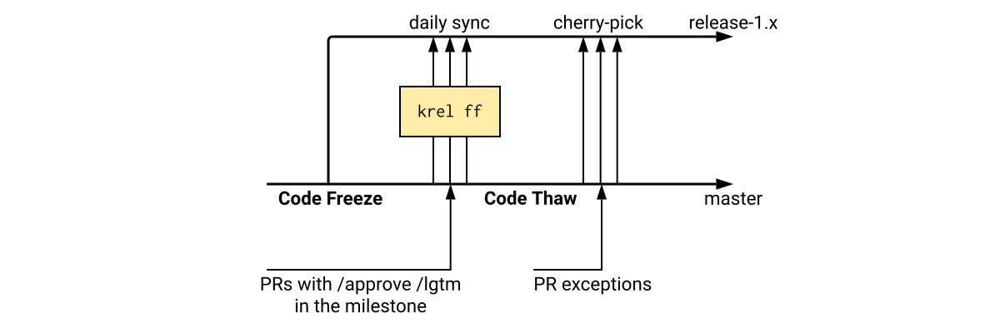

# Release Phases

The phases below are listed in the order in which they happen during a release
cycle. The exact dates for the current cycle are published in the release
directory under [`releases/`](./), for example
[releases/release-1.38/README.md](release-1.38/README.md).

- [KEP Readiness Deadline](#kep-readiness-deadline)
- [Enhancements Freeze](#enhancements-freeze)
- [Docs Placeholder PR Deadline](#docs-placeholder-pr-deadline)
- [Feature Blog Freeze](#feature-blog-freeze)
- [Code Freeze](#code-freeze)
- [Test Freeze](#test-freeze)
- [Burndown](#burndown)
- [Docs Ready for Review Deadline](#docs-ready-for-review-deadline)
- [Docs Freeze](#docs-freeze)
- [Thaw](#thaw)

The following sections describe processes that span several phases:

- [Exceptions](#exceptions)
- [Pruning](#pruning)
- [Docs](#docs)

## KEP Readiness Deadline

The KEP Readiness Deadline is a hard deadline happening one week before the [Enhancements Freeze]. After the KEP Readiness Deadline, no new KEPs may be opted into the milestone.

All enhancements wishing to be included in the current release must have an [open issue in kubernetes/enhancements](https://github.com/kubernetes/enhancements/issues/) that:
- is in the current Release Milestone
- has the `lead-opted-in` label applied

As described [here](https://github.com/kubernetes/community/blob/master/sig-architecture/production-readiness.md#submitting-a-kep-for-production-readiness-approval), by the KEP Readiness Deadline, KEP authors must have at least a PR opened in [kubernetes/enhancements] with:
- The KEP's [PRR questionnaire](https://github.com/kubernetes/enhancements/tree/master/keps/NNNN-kep-template#production-readiness-review-questionnaire) filled out
- The [kep.yaml](https://github.com/kubernetes/enhancements/blob/master/keps/NNNN-kep-template/kep.yaml) updated with:
    - `stage` set to the current stage
    - `latest-milestone` set to the current release
    - `milestone` struct updated with the current stage and release (only if graduating to a new stage)
- A [PRR approval file](https://github.com/kubernetes/enhancements/blob/master/keps/prod-readiness/template/nnnn.yaml) with the PRR approver listed for the stage the KEP is targeting

It is important to note that the KEP Readiness Deadline **_does not_** mean that the KEPs need to have received an approval or even a review from the PRR team by this date.

If the enhancement does not meet these requirements, it will be removed from the
milestone and will require an [Exception].

### PRR Freeze

As of v1.38, this deadline has been renamed to the [KEP Readiness Deadline].

## Enhancements Freeze

By enhancements freeze, all enhancements must have the [KEP Readiness Deadline] requirements listed above, as well as the following updates, merged into [kubernetes/enhancements]:

- The `kep.yaml` updated with:
    - `status` set to `implementable`
- A `README.md`
    - That uses the [latest template](https://github.com/kubernetes/enhancements/tree/master/keps/NNNN-kep-template)
    - That has up-to-date `Graduation Criteria`
    - That has an updated detailed `Test Plan` section filled out
- A completed [Production Readiness Review](https://github.com/kubernetes/enhancements/blob/master/docs/glossary.md#production-readiness-review-prr)

*Note*: For deprecations/removals, the `kep.yaml` status should be set to `withdrawn`, and the [Kubernetes Deprecation Policy](https://kubernetes.io/docs/reference/using-api/deprecation-policy/) should be followed.

If the enhancement does not meet these requirements, it will be removed from the
milestone and will require an [Exception].

## Docs Placeholder PR Deadline

Every enhancement that requires documentation must have a placeholder pull
request open against the `dev-1.XX` branch of [kubernetes/website] by this
deadline, a few weeks before [Code Freeze]. The placeholder does not need to
contain finished content. It must make clear which pages will change and who is
writing the documentation, and it must be linked from the enhancement on the
Release Tracking Board. See [Docs](#docs) for details.

## Feature Blog Freeze

Feature blogs are an amazing way to showcase all the hard work you and your team
have done with the enhancement. While providing technical depth in terms of content,
they are also great avenues to attract newer contributors to the Kubernetes project.
You can opt in to write a feature blog for your enhancement and this deadline is to
freeze the collection phase for the ongoing cycle. Once the collection phase is
completed, the Release Comms team will coordinate further with you to work out details
around delivery and review.

After the deadline passes if you haven't opted in and still would like to have a feature
blog for your enhancement, please contact the current release communications lead on
the #sig-release channel in Kubernetes Slack.

## Code Freeze

All enhancements going into the release must be in a merge-ready state with
`approved` and `lgtm` labels applied. This **includes** tests. Due to the Prow
queue, this may mean that approved PRs merge shortly after the deadline.

Docs placeholder PRs must already be open at this point (see the
[Docs Placeholder PR Deadline](#docs-placeholder-pr-deadline)). They don't
have to be ready to merge yet, but it's incredibly important that
documentation work gets completed as quickly as possible.

At this point, the only PRs allowed to proceed with changes are those
related to release-blocking issues within the milestone.

## Test Freeze

The date after which no more tests may be changed (or promoted to Conformance),
unless there are release-blocking or other exceptional reasons. Before
this date, it is acceptable to improve test coverage of existing code. After
this date, the goal is to fix, revert, or remove tests that are failing.

Test Freeze happens on the same day as [Code Freeze]. The release branch is
created later, together with the first release candidate. From then until
[Thaw], every PR merged into the `master` branch is automatically merged into
the release branch by the
[periodic release branch fast forward job](https://testgrid.k8s.io/sig-release-releng-blocking#git-repo-kubernetes-fast-forward)
in Prow.

## Burndown

Starting the week after [Code Freeze], we increase the cadence of release team
meetings to begin tracking work more closely. We call this Burndown, because at
this point we have a list of outstanding issues and PRs, and are actively working
to burn that list down. Burndown meetings take place three times a week at
first and daily in the last weeks before the release. SIG representatives will
be asked to attend if their SIG has specific outstanding issues that are
blocking the release.

Please subscribe to the [Kubernetes Release Calendar] to see meeting events. Burndown meetings
may conflict with other community meetings. Please prioritize this meeting if
a member of the release team asks you to attend.

The intent of these meetings is to:

* Focus on fixing bugs, eliminating test flakes and general release
  stabilization.
* Ensure docs and release notes are written and accurate.
* Identify all enhancement going into the release, and make sure alpha, beta, GA
  is marked in enhancements repo.
* Provide a one-stop view of release progress via the release meeting notes
  (linked from the `links.md` file in the release directory), including
  relevant release metrics.

## Docs Ready for Review Deadline

By this deadline, the placeholder PRs opened for the
[Docs Placeholder PR Deadline](#docs-placeholder-pr-deadline) must contain the
complete documentation and be marked ready for review, so that SIG Docs and the
Docs team have time to review them before [Docs Freeze].

## Docs Freeze

All enhancements that are determined to require documentation must have their docs PRs in a `ready to merge` state by the Docs Freeze deadline for the release. To be considered ready to merge, a PR must have a technical review as well as the `lgtm` and `approve` labels applied, with no outstanding comments or suggestions from SIG Docs.

After Docs Freeze, the owners of any outstanding documentation PRs must file an exception request. The release team will work with SIG Docs and the SIG or SIGs labeled in the pull request to determine whether or not an exception can be granted. Authors and reviewers should prioritize getting the PR into a state where it is accurate and useful enough to be merged even if it isn't perfect, and then open a separate PR to continue work on that documentation post-release.

## Thaw

Thaw specifies the end of both [Code Freeze] and [Test Freeze]. It happens on
release day. At this point it is expected that all outstanding PRs for the
release of Kubernetes have been merged into the release branch. Assuming the
release team agrees, [Code Freeze] will be lifted, and we enter Thaw. This means
from a technical perspective that now the `master` and `release-1.XX` branches
diverge. After Thaw, the `master` branch develops toward the next minor release
and the release branch goes into maintenance mode. From this point forward, any
PRs intended for the current release must be cherry-picked into the appropriate
branch.

## Exceptions

Starting at the [KEP Readiness Deadline], the release team will solicit and rule on
[Exception] requests for enhancements and test work that is unlikely to be done
by [Code Freeze]. The [Exception] approval is the responsibility of the SIG or SIGs
labeled in the pull request. The release team may intervene or deny the request
only if it poses a risk to release quality, or could negatively impact the overall
timeline. Changes introduced at this point should be well-tested,
well-understood, limited in architectural scope, and low risk. All of those
factors should be considered in the approval process. Enhancements on a
feature branch with documentation, test cases, and passing CI are more likely to
be accepted.

*Exception requests must be received within three days of the relevant freeze deadline to be considered.*

## Pruning

Enhancements that are partially implemented and/or lack sufficient tests may be
considered for pruning beginning after [Code Freeze], unless they've been
granted an [Exception].

The release team will work with SIGs and enhancements owners to evaluate each
case, but for example, pruning could include actions such as:

* Disabling the use of a new API or field
* Switching the default value of a flag or field
* Moving a new API or field behind an Alpha Enhancements gate
* Reverting commits or deleting code

This should occur before the first release candidate is cut so we have time to
gather signal on whether the system is stable in this state. These are
considered drastic measures, so the release team will strive to coordinate
at-risk work with SIGs before this time. The goal is to make code freeze, and
overall project transparency, enforceable despite the lack of a consistently
used feature branch process.

## Docs

If an enhancement needs documentation, set the docs field of the enhancement on
the Release Tracking Board (linked from the `links.md` file in the release
directory) and add a link to the documentation PR. You can open documentation
PRs in the [kubernetes/website] repository. If you have questions, the release
documentation lead, or representatives from SIG Docs will be happy to assist
you.

For documentation PRs:

* Open PRs against the `dev-1.XX` branch of [kubernetes/website], where `1.XX`
  is the release in development. The documentation workflow uses a dedicated
  branch for release documentation rather than basing from `main`. **Be sure to
  open your PR against the release branch, not `main`.**
* Add your PR to the current Release milestone.

[kubernetes/website]: https://github.com/kubernetes/website
[kubernetes/enhancements]: https://github.com/kubernetes/enhancements
[Kubernetes Release Calendar]: https://rel.k8s.io/release-team-cal
[Exception]: ./EXCEPTIONS.md
[KEP Readiness Deadline]: #kep-readiness-deadline
[Enhancements Freeze]: #enhancements-freeze
[Code Freeze]: #code-freeze
[Test Freeze]: #test-freeze
[Thaw]: #thaw
